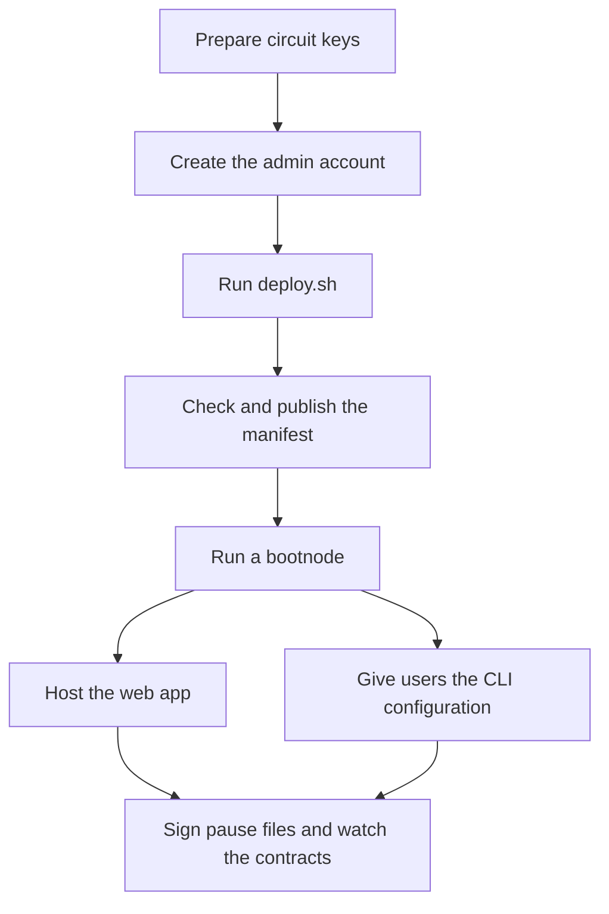

# Deploy a pool

This page takes a deployment from nothing to users transacting on a public network. The commands
use `testnet`; on another network, replace it with that network's Stellar CLI name. Decide the
values in [Configuration](configuration.md) first, because most can't change later.



## Prepare circuit keys

`deploy.sh` uses the verifying keys in `deployments/NETWORK/circuit_keys/` to pick each verifier
from the release, or to build it without one, and clients check their circuit files against
`deployments/NETWORK/circuits.json`. Testnet has both.
For any other network, start from the testnet files:

```bash
mkdir -p deployments/NETWORK
cp -R deployments/testnet/circuit_keys deployments/testnet/circuits.json deployments/NETWORK/
```

Replace `NETWORK` with the network's Stellar CLI name.

The committed keys come from a local setup, so whoever ran it could forge proofs. Before holding
real value, run a trusted setup ceremony with `tools/ceremony-cli`, export its keys into
`deployments/NETWORK/circuit_keys/`, and rewrite the lock with
`SPP_NETWORK=NETWORK make circuits-lock SETUP=ceremony`. For the ceremony, see the
[ceremony CLI README](https://github.com/NethermindEth/stellar-private-payments/blob/main/tools/ceremony-cli/README.md).

A contracts release holds verifiers only for the key files committed before it was published.
Mainnet always needs its own key files, and so does any network with ceremony keys: commit them
and publish a new release before you deploy.
[Deploy from a release](../deploy.md#deploy-from-a-release) lists what to commit.

## Create the admin account

Create the admin account before you deploy, so the contracts name it from the start.
[Set up the admin account](../governance.md#set-up-the-admin-account) gives its shape and the
commands. For a quick test, leave out `--admin` below, and the deployer becomes the admin.

## Run deploy.sh

Create and fund a deployer, which pays for the deployment:

```bash
stellar keys generate deployer --network testnet --fund
```

Then download a contracts release and deploy its contracts. This example deploys one native XLM
pool with the blocklist policy:

```bash
gh release download contracts-vVERSION --repo NethermindEth/stellar-private-payments \
  --dir RELEASE_DIR
deployments/scripts/deploy.sh testnet \
  --deployer deployer \
  --admin ADMIN_ACCOUNT \
  --policy-flags blocklist \
  --asp-levels 10 \
  --pool-levels 20 \
  --max-deposit 1000000000 \
  --kdf-domain KDF_DOMAIN \
  --pool native:$(stellar contract id asset --asset native --network testnet) \
  --release-dir RELEASE_DIR
```

Replace the following:

- `VERSION`: the contracts version to deploy, from the repository's releases.
- `RELEASE_DIR`: a new directory for the release's files.
- `ADMIN_ACCOUNT`: the admin account's address.
- `KDF_DOMAIN`: a string naming your deployment, which users see in the message they sign.

For more pools, GVK pools, classic assets, and a fork's own releases, see
[Deploying pools](../deploy.md).

`deploy.sh` first runs `gh attestation verify` to check that the repository's
`contracts-release.yml` workflow built and signed the release, and stops when the check fails. It
needs the GitHub CLI, `gh`, installed and logged in. It then deploys, in order: the allowlist, the
blocklist, one verifier for each policy and GVK mode in use, the public key registry, and each
pool. It writes the manifest and checks the deployment against it, as
[Deploy under the admin account](../governance.md#deploy-under-the-admin-account) describes.

Without `--release-dir`, `deploy.sh` builds the contracts itself, and the manifest records no
release. On mainnet, it refuses to build them unless you pass `--allow-unverified`.

`deploy.sh` copies the RPC URL and passphrase from your Stellar CLI's entry for the network into
the manifest. The bootnode uses that URL as its upstream unless `BOOTNODE_UPSTREAM_RPC_URL` is
set, and the web app falls back to it, so give the entry a public RPC URL with no API key in it.

## Check and publish the manifest

The manifest, `deployments/NETWORK/deployments.json`, is how every client finds the contracts:

| Field | Meaning |
| --- | --- |
| `network`, `networkPassphrase`, `rpcUrl` | The Stellar CLI network name, its passphrase, and the default RPC |
| `kdf_domain` | The KDF domain |
| `deployer`, `admin` | The deployer's and the admin's addresses |
| `asp_membership`, `asp_non_membership` | The allowlist and the blocklist |
| `asp_membership_wasm_hash`, `asp_non_membership_wasm_hash` | The tree code every pool accepts |
| `added_asp_memberships` | Allowlists added after deployment by a re-point, each with its deployment ledger |
| `verifiers` | The verifiers, one per key name: `B` for blocklist, `AB_gvk_T` for allowlist and blocklist with traceable GVK |
| `public_key_registry` | The registry |
| `pools` | One entry per pool: its address, token, asset, deployment ledger, policy, GVK mode and public key, and `enabled` |
| `contracts_release` | The release the contracts came from: its tag, repository, commit, release URL, and source archive hash; the network its verifiers were built for; and, under `code`, each deployed contract's Wasm hash. Absent when `deploy.sh` built the contracts itself |

Run the check again whenever the manifest changes:

```bash
deployments/scripts/verify-deployment.sh testnet
```

CLI users prove with three files per circuit: the `.r1cs` file that `make circuits` writes to
`target/circuits-artifacts/`, and the `.graph.bin` and `_proving_key.bin` files in
`circuit_keys/`. The CLI looks for them in a `circuits/` folder next to the manifest, so copy the
directory and add that folder:

```bash
make circuits
cp -R deployments/NETWORK publish
mkdir publish/circuits
for stem in $(jq -r 'keys[] | select(. != "meta" and . != "version")' publish/circuits.json); do
  cp target/circuits-artifacts/$stem.r1cs publish/circuit_keys/$stem.graph.bin \
    publish/circuit_keys/${stem}_proving_key.bin publish/circuits/
done
```

Publish `publish/` at a URL your users can download from, for example next to the web app.

## Run a bootnode

Clients rebuild their notes from contract events, and the public testnet RPC keeps events for
about seven days. After that, every new user, and every client that falls behind, needs a bootnode
that indexed the deployment from its first ledger. A bootnode started later can't fetch what the
RPC already dropped, so start one on the day you deploy.

The bootnode's Docker Compose file mounts the manifest named by `SPP_DEPLOYMENT_FILE` and passes it
to the bootnode as `BOOTNODE_DEPLOYMENT`. For a public bootnode, edit
`tools/bootnode/docker-compose.yml` first: set `BOOTNODE_DOMAIN` and `BOOTNODE_ACME_EMAIL` to your
domain and email for its TLS certificate, and change the PostgreSQL password and stop publishing
port 5432. Then, on a host that port 443 reaches:

```bash
cd tools/bootnode
SPP_DEPLOYMENT_FILE=/absolute/path/to/deployments.json docker compose up --build -d
```

The `docker-compose.no-https.yml` override serves plain HTTP for local testing only; an app served
over HTTPS can't call it. For systemd and every setting, see the
[bootnode README](https://github.com/NethermindEth/stellar-private-payments/blob/main/tools/bootnode/README.md).
Users trust the bootnode for the history it serves; for what it can do to them, see
[Bootnode](../bootnode.md).

## Host the web app

The app falls back to the project's hosted bootnode, which indexes only the project's own
manifest. Set `DEFAULT_BOOTNODE_URL` in `app/js/app-storage.js` to your bootnode, then build the
app for your manifest:

```bash
make circuits
SPP_NETWORK=NETWORK make release DIST_DIR=site PUBLIC_URL=/
```

Serve the `site/` directory as static files over HTTPS. It holds the user app at `index.html`, the
admin page at `admin.html`, the manifest, and the circuit files. Set `PUBLIC_URL` to the path you
serve it under. One build serves one manifest, so rebuild after every manifest change.

The site includes compiled circuits under the LGPLv3, which makes you their distributor. See
[Responsibility of deployers](../introduction.md#responsibility-of-deployers).

## Give users the CLI configuration

The [install script](../introduction.md#install-the-cli) sets the CLI up for the project's testnet
manifest. Your users download your deployment directory and point the CLI at it and at your
bootnode:

```bash
spp --deployment /path/to/NETWORK onboard --account ACCOUNT --bootnode-url BOOTNODE_URL
```

Replace the following:

- `/path/to/NETWORK`: where the user saved your deployment directory.
- `ACCOUNT`: the user's Stellar CLI identity.
- `BOOTNODE_URL`: your bootnode's URL.

A user who sets `deployment` under `[defaults]` in `~/.config/spp/config.toml` can leave out
`--deployment`.

The CLI reads the RPC URL and passphrase from the user's Stellar CLI entry named like the
manifest's `network`, and refuses one whose passphrase differs. On a network other than testnet,
users add the entry first:

```bash
stellar network add NETWORK --rpc-url RPC_URL --network-passphrase "PASSPHRASE"
```

Replace `NETWORK`, `RPC_URL`, and `PASSPHRASE` with the manifest's `network`, `rpcUrl`, and
`networkPassphrase`.

## Sign pause files and watch the contracts

Before users arrive, have the admin account's signers sign a pause file for each pool, as
[Pre-sign deposit pauses](../governance.md#pre-sign-deposit-pauses) describes. Then watch the admin
account and the contracts for the events that
[Watch the account and the contracts](../governance.md#watch-the-account-and-the-contracts) lists.
The repository ships no watcher, so run one of your own.

## Check a deployment's code

Anyone with a deployment's manifest can check its contracts' code. `verify-deployment.sh`, the
check `deploy.sh` runs, compares each contract's Wasm hash on chain with `contracts_release.code`.
It also reads the build options each Wasm records in its meta, the contract metadata
`stellar contract info meta` prints, to confirm the Wasm was built from the right package for that
contract and, for a verifier, with its key. To check the release itself, download it and pass it
to `--rebuild`:

```bash
MANIFEST=deployments/testnet/deployments.json
gh release download "$(jq -r .contracts_release.tag "$MANIFEST")" \
  --repo NethermindEth/stellar-private-payments --dir RELEASE_DIR
deployments/scripts/verify-deployment.sh testnet --manifest "$MANIFEST" --rebuild RELEASE_DIR
```

Replace `RELEASE_DIR` with a new directory. For a fork's release, pass the fork to `--repo` and
to `--release-repo`.

With `--rebuild`, the check runs the same `gh attestation verify` as `deploy.sh` and checks each
contract against the release's `contracts.json`, including the SHA-256 of the key file each
verifier embeds. Last, unless an earlier check failed, it rebuilds every Wasm from the release's
source archive with `scripts/build-contracts.sh --rebuild` and compares hashes. The rebuild needs
Docker, and the attestation check needs `gh` installed and logged in: without it, the check fails
unless you pass `--allow-unverified`.

In the output, read the `attestation` line first. A rebuild proves only that the files rebuild
from the source archive they came with, and a release built from any source passes it. The
attestation proves where the files came from: the `contracts-release.yml` workflow on the
repository's `main` branch.

Every build runs in one build image, pinned by digest in `scripts/build-contracts.sh` and recorded
in each Wasm's `bldimg` meta entry. SEP-58 requires a single-platform image, and this one is
amd64, so on Apple silicon Docker runs it under emulation, which is slower. A build outside the
image never matches a release: each Wasm records the Stellar CLI and Rust versions that built it,
so another CLI or toolchain gives another hash from the same source.

To rebuild one contract by hand, as SEP-58 describes, pass every meta entry that follows `cliver`
back to the build with `--meta`, in order. That includes `source_repo`, which SEP-58 does not
define; leaving any entry out changes the meta the build writes, and so the hash. In an empty
directory, run:

```bash
ID=CONTRACT_ID
stellar contract info meta --contract-id "$ID" --network testnet --output json \
  | jq -r '[.[].sc_meta_v0] | .[(map(.key) | index("cliver")) + 1:][] | "\(.key)=\(.val)"' \
  > meta.txt
meta() { sed -n "s/^$1=//p" meta.txt; }
curl -fsSL -o contracts-source.tar.gz "$(meta source_uri)"
shasum -a 256 contracts-source.tar.gz
tar -xzf contracts-source.tar.gz
flags=() metas=()
while IFS= read -r f; do flags+=("$f"); done < <(meta bldopt)
while IFS= read -r m; do metas+=(--meta "$m"); done < meta.txt
docker run --platform linux/amd64 --rm -v "$PWD/source:/source" "$(meta bldimg)" \
  contract build "${flags[@]}" "${metas[@]}"
shasum -a 256 source/target/wasm32v1-none/release/*.wasm
stellar contract info hash --contract-id "$ID" --network testnet
```

Replace `CONTRACT_ID` with the contract's address. The archive's hash must equal `source_sha256`
in `meta.txt`, and the built Wasm's hash must equal the contract's. On Linux, unless your user ID
is 1000, the image's user can't write `source/`; add
`--user "$(id -u):$(id -g)" -v "$(mktemp -d):/stellar"` to the `docker run`, as
`build-contracts.sh` does.

To build a release's files yourself, run `scripts/build-contracts.sh --out DIR` from a fresh clone
or from a worktree made with `git worktree add`. The script archives the checkout with
`stellar contract build archive`, which needs Stellar CLI 28.1.0 or later and refuses a checkout
with uncommitted changes or untracked files, even files listed only in `.git/info/exclude`. `DIR`
must be new or empty, and outside the checkout. To compare the output with a release, build the
release's commit with its tag and repository as `--tag` and `--repo`, because both are recorded in
the meta.
