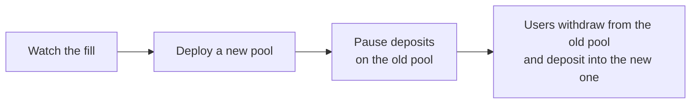

# Features and limits

## Web app

The user app has four views:

| View | What a user can do |
| --- | --- |
| Overview | See balances, notes, and recent activity across the deployment's pools |
| Move Funds | Deposit, transfer to a Stellar address or to a pair of public keys, and withdraw |
| Advanced | Choose which notes to spend and how to split the outputs |
| Disclosure | Generate a disclosure receipt, or verify one with no wallet |

On first use, the app asks the user to sign one message, from which it derives their keys, and
offers to register them in the public key registry. Settings show the user's public keys and ASP
secret, and set the bootnode and explorer URLs. A user can sign and pay with a different account
from the one that owns their notes.

## Admin page

The admin page builds every admin call. When the connected account can sign a call alone, it signs
and sends it at once. Otherwise the call waits in the Admin Transaction card, where the admin
account's signers review, sign, and submit it. Its tabs:

| Tab | Purpose |
| --- | --- |
| Overview | The tree addresses the other tabs write to, and each tree's state |
| Allowlist | Add members |
| Blocklist | Add and remove keys |
| Global View | Decrypt and export a GVK pool's notes with the GVK private key |
| Pools | Pause and unpause deposits, check and build re-points, and make, sign, and send pause files |
| Admins | Propose, cancel, and accept admin transfers |

## CLI

The `spp` command-line client covers the user side of the app: `onboard`, `register`, `deposit`,
`transfer`, `withdraw`, `transact`, `overview`, `notes`, `feed`, `keys`, `asp-secret`, and
`disclosure generate` and `disclosure verify`. `transact` chooses the notes to spend and the
outputs, as [Advanced transactions](../transact.md) describes. The CLI signs with Stellar CLI
identities. It has no admin commands; admin calls go through the admin page or the Stellar CLI.

## SDKs

The Rust crate `stellar-private-payments` and the npm package `stellar-private-payments` expose
the same operations to other applications. See the
[Rust SDK README](https://github.com/NethermindEth/stellar-private-payments/blob/main/sdk/native/README.md)
and the
[browser SDK README](https://github.com/NethermindEth/stellar-private-payments/blob/main/sdk/web/README.md).

## Support

| Area | Supported |
| --- | --- |
| Assets | Native XLM and classic assets. `deploy.sh` warns when the issuer can freeze or claw back the pool's balance. |
| Browser wallets | Freighter |
| Browsers | Chromium-based browsers are tested. The app needs the Origin Private File System and web workers. |
| Networks | Any Stellar network with a manifest. The repository holds a testnet manifest; `deploy-local.sh` makes a local one. |

## Limits

| Limit | Value |
| --- | --- |
| Notes per transaction | Two spent, two created |
| Transactions per pool | 524,288, filling its commitment tree of 2^20 commitments |
| Allowlist members | 1,024 per allowlist |
| Blocklist depth | 31 levels. A key that shares its lowest 31 bits with two blocked keys can't spend or deposit. |
| Notes per disclosure receipt | One to four. A receipt stops verifying once 90 more transactions land in the pool. |
| Contracts per manifest | 25 that clients index: the enabled pools, every allowlist, and the registry |
| Event history | About seven days on the public testnet RPC. Older history needs a bootnode. |
| Contract upgrades | None. A fix means new contracts. |

Some limits are build parameters. Changing one means rebuilding and redeploying:

- Commitment tree depth (20): new keys for every circuit, and new pools.
- Allowlist depth (10) and blocklist depth (31): new transaction keys, and new pools. A deeper
  allowlist also needs new allowlists.
- Notes per disclosure receipt (4): new disclosure keys only. Nothing on chain changes.
- Root history (90): a contract constant. New pools and allowlists, no new keys.

### A full pool

Warning: once a pool's commitment tree is full, the pool refuses every transaction with
`MerkleTreeFull` (#2), withdrawals included, and the tokens left in it can never leave.

Every transaction takes two slots, whoever sends it and whatever it moves. Pausing deposits
doesn't stop the tree filling, because transfers and withdrawals still go through. Users leave a
pool only by withdrawing, and a withdrawal spends at most two notes, so emptying a pool needs room
too. No contract reports how many notes a pool still holds, so move users long before the tree
fills:



The `index` in a pool's latest `new_commitment_event` is the number of slots used, less one, out
of 1,048,576. A new `deploy.sh` run writes a manifest with only the pools it deployed, so keep
serving a client built from the old manifest until the old pool's users have left.

### A key the blocklist can't clear

The circuits check blocklist paths of up to 31 levels. If two blocked keys share the lowest 31
bits of a user's key, the user can't prove their key is unlisted, and the client fails with:

```text
ASP non-membership proof has N sibling(s), but the policy SMT depth 32 proves at most 31
```

The user's funds are safe but frozen until you remove one of the two blocked keys, which unblocks
that key too. With 100,000 blocked keys, about one key in a billion is affected. Forcing it takes
about 2^32 hashes and getting both keys blocked.

More levels make this rarer and harder to force, but slow down proving. All 254 levels would make
the blocklist circuits several times larger. The depth is fixed in the circuits, so changing it
means new circuits, keys, and pools.

## Known gaps

- Contract storage expires when unused. A call that reads an archived entry restores it and pays
  for the restore, which can cost several XLM.
- Browser storage can be lost, for example to antivirus software. The user signs again to recover
  their keys, and the client rebuilds their notes from events. App settings and the record of past
  operations are lost.
