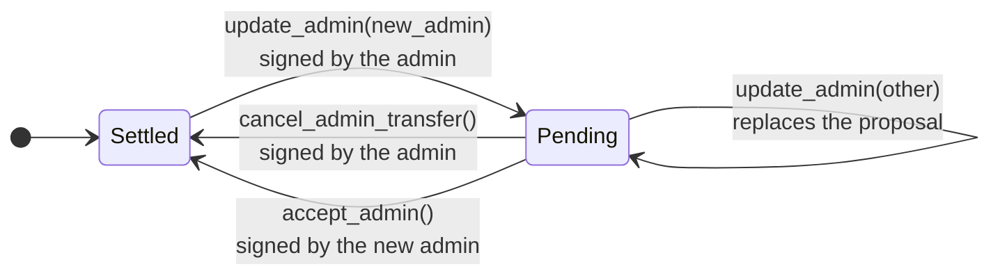
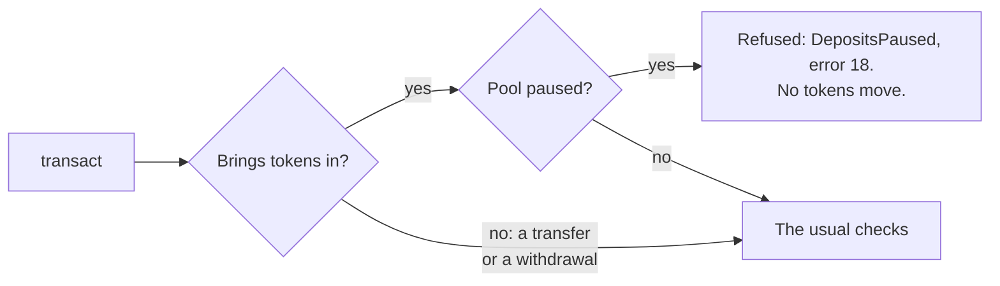
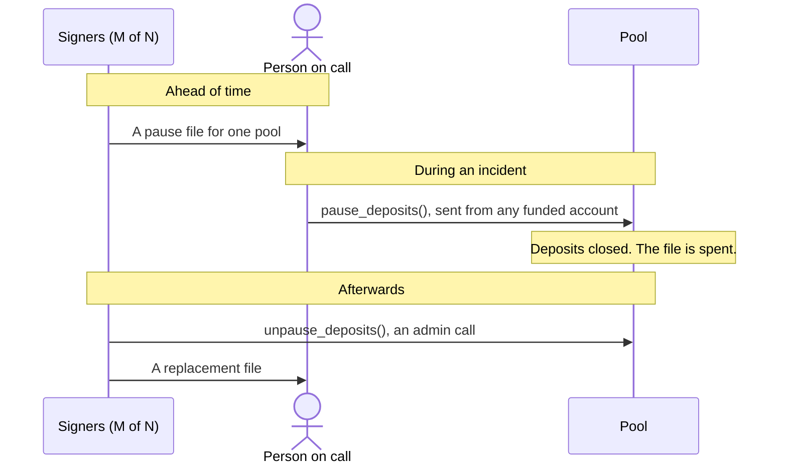

# Governance

Each pool and each tree has one admin, set at construction, and `deploy.sh` gives them all the same
one. Use a Stellar account as the admin, made M-of-N with M of at least 2, so no single lost or
stolen key controls the deployment. `verify-deployment.sh` fails a contract admin on mainnet,
because it has no signers to check. This page explains the model; the
[Governance runbook](../governance.md) has the procedures.

## What the admin can do

| The admin can | The admin can't |
| --- | --- |
| Pause and unpause deposits into a pool | Stop transfers or withdrawals |
| Add allowlist members, add and remove blocklist entries | Remove an allowlist member except by re-pointing |
| Re-point a pool to another tree of its tree code | Re-point to a tree of other code |
| Propose a new admin, or cancel the proposal | Change the token, verifier, maximum deposit, policy, or GVK |
| | Upgrade any contract |

Every admin call needs M signatures. The admin page builds the call, and each signer reviews and
signs it on their own device before anyone submits it. A connected account that can sign alone,
such as a single-key admin, signs and sends the call at once.

## Transfer the admin

A transfer takes two calls on each pool and tree, one from each side:

The current admin keeps every power until the new admin accepts, so a proposal to a wrong address
does no harm. Transfer the admin only to move the contracts to another organization's account. To
change who signs, replace signers on the same account; that needs no contract call.

## Pause deposits

A pause closes one pool to deposits. The pool refuses every `transact` that brings tokens in,
before any token moves, and handles transfers and withdrawals as before:

Warning: a pause doesn't freeze a pool. Users keep transferring and withdrawing, and each of
those transactions still fills the commitment tree, as
[A full pool](features-and-limits.md#a-full-pool) explains. No call stops withdrawals: the
contracts can't be upgraded, so a stop would have no fix to wait for.

A pause covers one pool and has no end. Deposits stay closed until the admin calls
`unpause_deposits`. The app and the SDK refuse a deposit into a paused pool before proving, and
the app tells the user that transfers and withdrawals still work.

Collecting M signatures takes longer than a soundness bug in a circuit or contract allows, so the
signers sign pause files ahead of time and give one per pool to each person on call:

Whoever keeps a file can pause and can't unpause. Each file works once and expires
`max_entry_ttl - 1` ledgers after it is built, about 180 days on testnet and mainnet. An admin
transfer voids it, and so does a signer change that leaves its remaining signatures short of the
threshold.

## If the admin account is lost or stolen

The design trusts the admin account's signers with every decision about who may use the pools.
Admin calls take effect in the ledger they land in, with no delay and no notice to users. The code
keeps two things from the admin: moving funds and changing contract code.

| Case | What follows | Response |
| --- | --- | --- |
| Lost: fewer than M signers remain | Every setting stays as it is. Users keep transacting under the current lists, and an unused pause file can still close deposits for good. | Deploy new contracts and move users |
| Stolen: someone else controls M signers | They can freeze users, by listing keys or re-pointing a pool to an empty allowlist, admit anyone, keep deposits closed, and transfer the admin to themselves. They can't move funds. | Warn users, deploy new contracts, and move users |

## Procedures

| Task | Runbook section |
| --- | --- |
| Create the admin account | [Set up the admin account](../governance.md#set-up-the-admin-account) |
| Watch the account and the contracts | [Watch the account and the contracts](../governance.md#watch-the-account-and-the-contracts) |
| Sign and submit an admin call | [Make an admin call](../governance.md#make-an-admin-call) |
| Sign pause files | [Pre-sign deposit pauses](../governance.md#pre-sign-deposit-pauses) |
| Hand the contracts to another account | [Transfer the admin](../governance.md#transfer-the-admin) |
| Switch a pool to another tree | [Re-point a pool](../governance.md#re-point-a-pool) |
| Replace a signer | [Replace a signer](../governance.md#replace-a-signer) |
| Respond to a lost key, a bug, or a sanction | [Incidents](../governance.md#incidents) |
